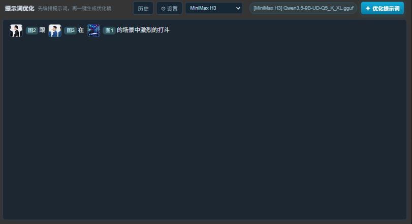
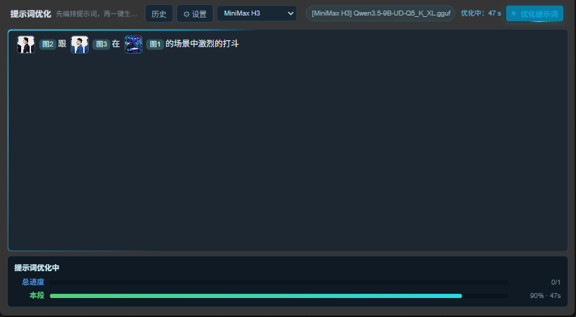
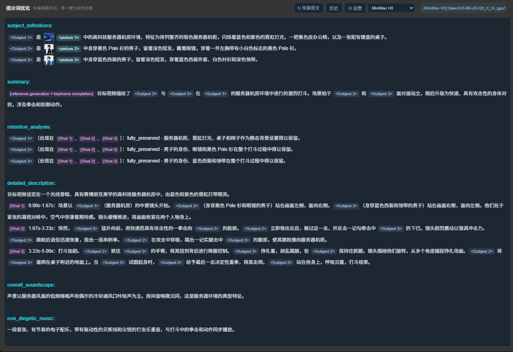
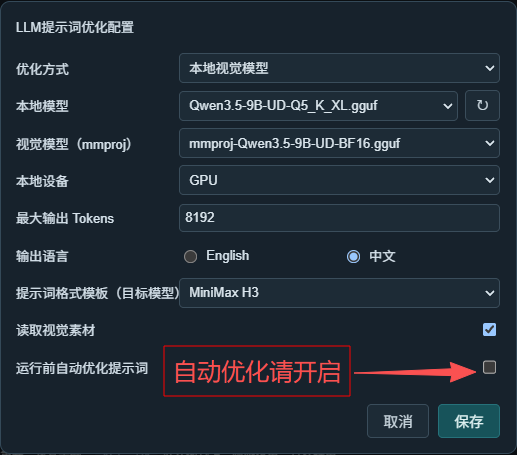
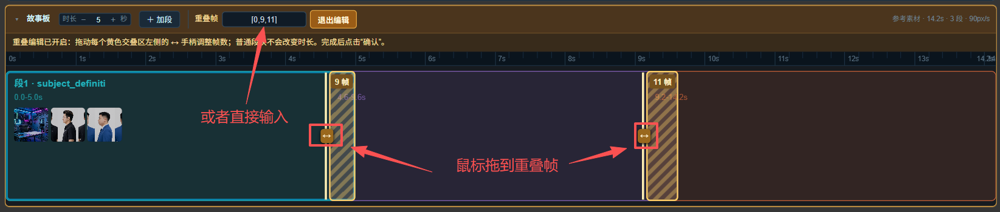
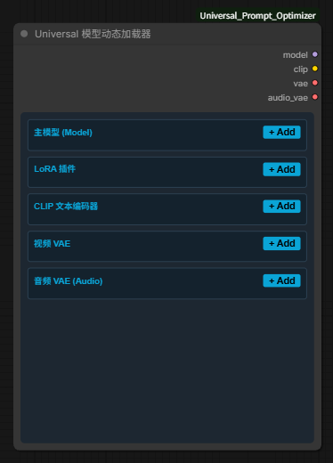
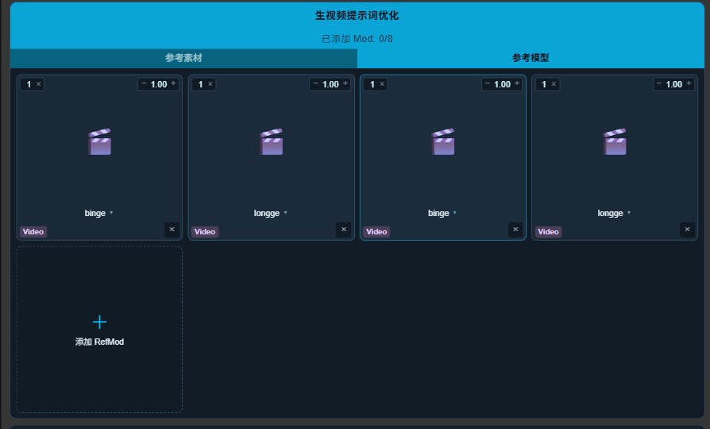

# ComfyUI Universal MiniMax H3 Ecosystem

[English](#english) | [中文](#中文)

---

## English

The ultimate, all-in-one ecosystem for MiniMax H3 video generation. Turn rough ideas into production-ready videos with just **3 nodes**, keeping your canvas clean and your workflow lightning fast.

### 🌟 Director Max Core Features

1. **Auto-Prompt Engine**: Built-in LLM optimizer (Local GGUF / Online API). Converts plain language (e.g., "Image 1 and 2 fight in Image 3's scene") into H3's standard 6-section prompt, automatically adapting action beats based on your target duration.
2. **Infinite Length & Smart Storyboard**: Seamless multi-segment video generation. Adjust "overlap frames" for silky-smooth transitions or use hard cuts. Generate videos of any length (limited only by your VRAM).
3. **Audio Driving**: Supports reference audio for voice cloning. Lock audio tracks as BGM or force specific dialogue (single track).
4. **Dual 2-Stage Upscaling**:
   - **Selflift (Speed)**: Fully automated 1st + 2nd stage. Benchmark (5070Ti, 0.4mp, 8 steps): **Only 79.9 seconds!**
   - **Refine (Quality)**: High-definition automated pipeline.
   - **Manual Mode**: Generate a draft first, pick the best one, then manually trigger the 2nd stage.
5. **Video Reference**: Use a reference video to guide the motion and action of your generated video.
6. **RefMod Character Consistency**: Pre-injects latent features for incredible biological character consistency. Keep faces identical even during turns, occlusions, and re-appearances.

### 🧩 The 3-Node Workflow Architecture

Forget messy spaghetti graphs. The ecosystem includes a dynamic **Universal Model Loader** (loading Models, LoRA, CLIP, VAE, audio VAE in one node).

**Loader** → **Director Max** → **Save Video**

### 📦 Backward Compatibility & Bridges

- **Prompt Optimizer Node**: Still fully supported for image generation (Flux, Z-Image, etc.) and video prompts.
- **AIMixer R2V Bridge**: Connect the optimizer to AIMixer's Director for single-segment generation.
- **TimelineDirector Bridge**: Connect for multi-segment and two-stage sampling via Songssx's TimelineDirector.

### 📸 Screenshots

**Director Max Core UI & Node Workflow**


**Auto-Prompt Engine (Before / Processing / After)**





**Smart Storyboard & Segment Overlap**


**Universal Model Loader & RefMod Support**



### 🗂️ Example Workflows

Load these files directly into ComfyUI:

- **[`workflows/00-MiniMax_H3全能导演台Max.json`](workflows/00-MiniMax_H3全能导演台Max.json)** — **The Ultimate Default Workflow for Director Max (Start Here!)**
- [`workflows/01-director-full-r2v导演台外接.json`](workflows/01-director-full-r2v导演台外接.json) — Legacy pipeline with AIMixer Director integration.
- [`workflows/02-image-demo-生图.json`](workflows/02-image-demo-生图.json) — Image prompt optimization demo.
- [`workflows/03-unlimited-two-stage-小黄瓜多段.json`](workflows/03-unlimited-two-stage-小黄瓜多段.json) — Legacy unlimited-length workflow via TimelineDirector.

### Installation

```bash
cd ComfyUI/custom_nodes
git clone https://github.com/aihaipan/ComfyUI-Universal_Prompt_Optimizer.git
```

Restart ComfyUI.

Configuration
Open the ⚙ settings panel to configure your LLM backend (Local GGUF or Online API) and output language.

Credits
Core prompt optimization pipeline and frontend editor framework derived from goohai's Goohai-MiniMax-H3_Integration. Licensed under GPL-3.0.

Special thanks to:

AIMixer/ComfyUI_MiniMaxH3_Director for the R2V bridge foundation.

Songssx/ComfyUI-MiniMaxH3-TimelineDirector for the Finite Segment bridge.

Luisacaotica for the ComfyUI-MiniMaxH3Mod plugin powering RefMod support.

License
GPL-3.0-or-later


中文
终极的 MiniMax H3 视频生成全能生态。仅需 3 个节点，即可将大白话想法转化为高质量视频，告别凌乱的画布，体验极致的生成速度。

🌟 导演台 Max 核心功能
全自动提示词引擎：内置本地 GGUF / 在线 API 优化器。一键将大白话转为 H3 标准 6 段式提示词，并根据设定时长自动增删打斗动作与分镜。

无限时长与智能故事板：集成多段故事板衔接。支持调整“重叠帧”实现段与段之间的丝滑过渡，或选择硬切。突破单次生成时长限制。

音频驱动与音轨锁定：支持参考音频生成对白，支持锁定音轨作为 BGM 或强制对白（单轨锁定）。

双二采放大模式：

Selflift (极速)：全自动一采+二采。实测数据（5070Ti，0.4mp，8步）：仅需 79.9 秒！

Refine (高清)：全自动一采+二采，追求极致画质。

手动模式：支持“手动一采+手动二采”，先抽卡，满意后再放大，极致节省时间。

视频动作参考：支持让素材参考视频动作，生成动作一致的视频。

RefMod 角色一致性：兼容以上所有功能。通过提前注入 latent，让模型更清晰生动，特别针对生物模型，保证脸部在转身、遮挡重新出现等场景下高度一致。

🧩 极致精简的 3 节点生态
包含一个强大的 Universal 模型动态加载器（单节点即可加载主模型、LoRA、CLIP、VAE、VAE_Audio 等）。告别凌乱连线。

模型动态加载器 → 导演台 Max → 保存视频

📦 兼容与桥接
万能提示词优化节点：依然保留，支持生图（Flux/Z-Image等）及单段提示词优化。

AIMixer R2V 桥接：连接至 AIMixer 导演台（单段）。

TimelineDirector 桥接：连接至小黄瓜采样器（多段 + 二采）。

### 📸 界面截图

**导演台 Max 核心 UI 与节点工作流**


**全自动提示词引擎（优化前 / 优化中 / 优化后 / 自动优化设置）**


**智能故事板与段间重叠**


**动态模型加载器与 RefMod 支持**


🗂️ 示例工作流
直接在 ComfyUI 中拖入这些 JSON 文件即可加载：

workflows/00-MiniMax_H3全能导演台Max.json — 导演台 Max 终极默认工作流（强烈推荐从这里开始！）

workflows/01-director-full-r2v导演台外接.json — 旧版：含 AIMixer 导演台整合。

workflows/02-image-demo-生图.json — 生图提示词优化演示。

workflows/03-unlimited-two-stage-小黄瓜多段.json — 旧版：通过 TimelineDirector 实现的无限时长生成。

安装
```bash
cd ComfyUI/custom_nodes
git clone https://github.com/aihaipan/ComfyUI-Universal_Prompt_Optimizer.git
重启 ComfyUI。
```

配置
打开 ⚙ 设置面板配置优化方式（本地 GGUF 或在线 API）及输出语言。

致谢 / Credits
本插件的核心提示词优化管线及前端编辑器框架源自 goohai 的开源项目 Goohai-MiniMax-H3_Integration。遵循 GPL-3.0 协议。

同时特别感谢：

AIMixer/ComfyUI_MiniMaxH3_Director 提供的 R2V 桥接底子。

Songssx/ComfyUI-MiniMaxH3-TimelineDirector 提供的有限分段采样底子。

Luisacaotica 提供的 ComfyUI-MiniMaxH3Mod 插件与 RefMod 支持。

许可证
GPL-3.0-or-later